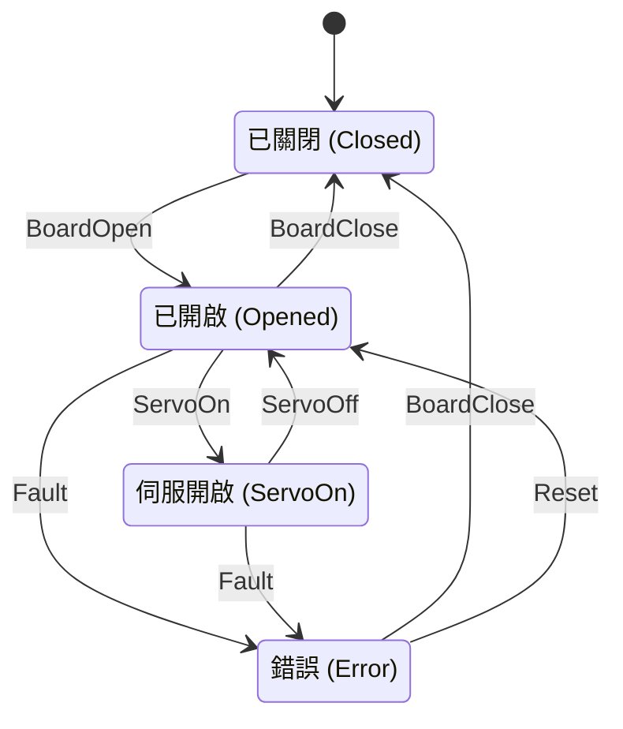
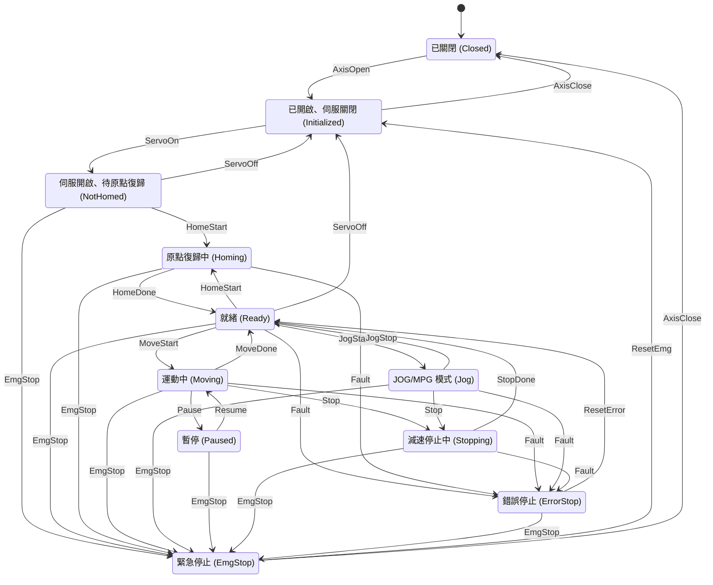

| 狀態    | 說明                           |
| ------- | ------------------------------ |
| Closed  | 控制卡未開啟                   |
| Opened  | 控制卡已開啟，伺服關閉         |
| ServoOn | 所有軸伺服開啟，可接受運動命令 |
| Error   | 控制卡或軸發生嚴重錯誤         |

| 觸發器 (Trigger)   | 對應方法                      |
| ------------------ | ----------------------------- |
| BoardOpen          | BoardOpen()                   |
| BoardClose         | BoardClose()                  |
| ServoOn / ServoOff | ServoOn() / ServoOff()        |
| Fault              | 輪詢偵測到錯誤或 API 回傳失敗 |
| Reset              | ResetAxisState() 或重新開啟   |

| 狀態      | 對應硬體旗標                                               |
| --------- | ---------------------------------------------------------- |
| Disabled  | STA_AX_DISABLE                                             |
| Ready     | STA_AX_READY                                               |
| Moving    | STA_AX_PTP_MOTION、STA_AX_CONTI_MOTION、STA_AX_SYNC_MOTION |
| Homing    | STA_AX_HOMING                                              |
| Jog / Mpg | STA_AX_EXT_JOG、STA_AX_EXT_MPG                             |
| Stopping  | STA_AX_STOPPING                                            |
| Paused    | STA_AX_PAUSE                                               |
| ErrorStop | STA_AX_ERROR_STOP                                          |

| 觸發器 (Trigger)                   | 對應方法                     |
| ---------------------------------- | ---------------------------- | --- | -------------------- | -------------------- |
| ServoOn / ServoOff                 | 伺服開關                     |
| MoveStart / MoveDone               | 運動開始、完成（由輪詢判定） |     | HomeStart / HomeDone | AxisHome()、輪詢判定 |
| JogStart / MpgStart / ExtDriveStop | SetExtDrive(axis, 1/2/0)     |
| Stop                               | AxisStop()                   |     | EmgStop              | AxisStopEmg()        |
| Pause / Resume                     | 暫停、恢復                   |
| Fault                              | 輪詢偵測到 STA_AX_ERROR_STOP |
| ResetError                         | ResetAxisState()             |

